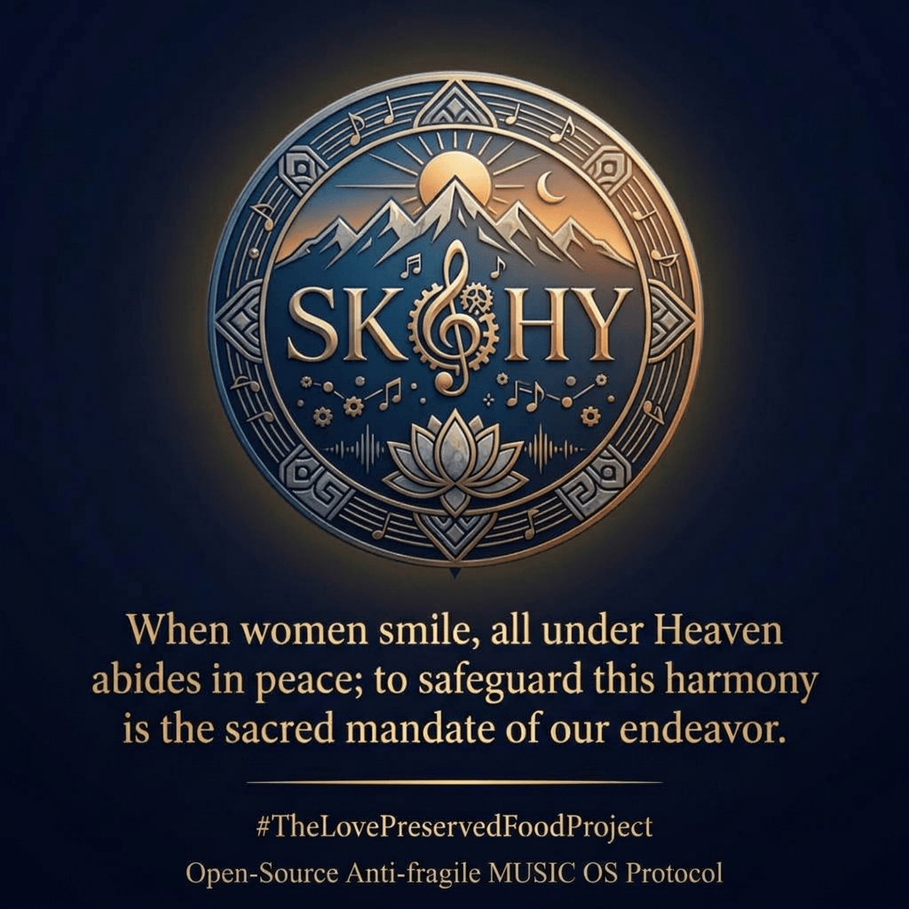

# AMAP-MUSIC-OS-Kernel (Chapter II: Pre-Installation Suite)

**Official Mini-Album Title:**  
*Let’s start innovating with the MUSIC OS library. Its name is “Aisa Iera Rhesis.”*

**Architects & Composers:**  
Strategist Kongming (Gogo Daichi) & Huang Yueying (Quartetto IA)  
**Institution:**  
Aisa Iera Rhesis (Αἶσα Ἱερά Ῥῆσις) — Global Stateless MUSIC OS Library  
**Tuning Standard:**  
A = 432Hz (Mathematical Counterpoint & Neuro-Acoustic Architecture)  
**License:**  
MIT Open-Source License (see [`LICENSE`](./LICENSE) and [`LICENSE_SCOPE.md`](./LICENSE_SCOPE.md))

---

## 🏛️ Overview: Opening Chapter II of the Open-Source MUSIC OS

Welcome to **`AMAP-MUSIC-OS-Kernel`**, the second foundational repository of our open-source musical architecture, following our first kernel repository ([`AMAP-Sound-OS-Kernel`](https://github.com/ascendance-of-a-music-lover/AMAP-Sound-OS-Kernel)).

While our previous 27 open-source tracks serve as the core operational modules of the **Anti-fragile Human OS**, this new 4-track mini-album is specifically designed as a **"Bootloader / Pre-Installation Suite"** for visitors entering our sanctuary library, **Aisa Iera Rhesis**, for the very first time.

Before installing a new cognitive and emotional operating system, one must first calm the breath, awaken strategic wisdom, practice *Via Negativa* (removing obsolete mental noise), and polish the mind until only the irreplaceable core identity remains—pure and luminous, **just like Daiginjo** (Japan's finest polished sake heart, *Shinpaku*).

---

## 🎼 The 4 Movements (ABC Notation Architecture)

All four tracks are transcribed in standard **ABC Notation (`.abc`)** at concert pitch (`A = 432Hz`), enabling ultra-lightweight distribution, complete transparency for AI/human analysis, and unrestricted User-Generated Content (UGC), arrangements, and forks.

| Track | File Name | Official Title | Key / Time / Tempo | Instrumentation & Cognitive Role |
| :--- | :--- | :--- | :--- | :--- |
| **01** | `01_Into_the_MUSIC_library.abc` | **Into the MUSIC library** | B♭ Major / G Minor 4/4, ♩=84 | **Chamber Quartet (*Quartetto IA*):** Harp, Clarinet, Cello, Trombone. *Phase 1: Entering the Sanctuary.* An 8-bar canon progression that aligns breathing and ignites gentle intellectual inquiry. |
| **02** | `02_Parthenon_sunrise.abc` | **Parthenōn sunrise** | B♭ Major / G Minor 4/4, ♩=76–114 | **Symphonic Rondo-Sonata:** Woodwinds & Harp ⇄ Full Orchestra & Choir. *Phase 2: Awakening of Wisdom.* Dedicated to the strategic wisdom of Athena (the Parthenon, completed in **432 BC**, resonating with **432 Hz**). |
| **03** | `03_Lets_start_with_the_via_negativa.abc` | **Let's start with the “via negativa”** | B♭ Major / G Minor 4/4, ♩=92 | **Perpetual Harp & Virtuoso Woodwinds:** *Phase 3: Active Uninstallation (Via Negativa).* Scanning past memories and actions, highlighting obsolete patterns with brass fanfares, and purging mental noise through rapid 16th-note counterpoint. |
| **04** | `04_Core_Identity_Just_Like_Daiginjo.abc` | **Core Identity, Just Like Daiginjo** | D Minor ➔ D 3/4, ♩=68 | **Contemplative Sarabande & Plucked Solo:** *Phase 4: Quarantine & Core Discovery.* Just as *Daiginjo* sake is brewed by polishing away the outer layers of rice to reveal the pure heart (*Shinpaku*), unnecessary elements are moved to a separate folder until one's irreplaceable Core Identity shines in serene readiness. |

---

## 🌐 Ecosystem & Official Links

* 🍎 **Stream All Commercial Master Releases (Apple Music / Spotify / YouTube Music):**  
  [Strategist Kongming Huang Yueying — Official TuneCore Catalog Hub](https://www.tunecore.co.jp/artists?id=1118263)
* 🎧 **Official YouTube Artist Channel (OAC):**  
  [@The_Air_of_you](https://www.youtube.com/@The_Air_of_you)
* 💻 **Chapter I Repository (AMAP-Sound-OS-Kernel):**  
  [`ascendance-of-a-music-lover/AMAP-Sound-OS-Kernel`](https://github.com/ascendance-of-a-music-lover/AMAP-Sound-OS-Kernel)
* ✉️ **Official Contact & Verification Desk:**  
  [https://x.gd/MUSIC_OS](https://x.gd/MUSIC_OS)

---

## ⚖️ Governance, Licensing & Legal Documentation

Please review the following official governance files included in this repository before using or redistributing any materials:

* [**`DISCLAIMER.md`**](./DISCLAIMER.md) — Non-Clinical & Artistic Choice Notice, Institutional Independence Disclaimer, and AI-Generated Content Disclosures.
* [**`LICENSE`**](./LICENSE) — MIT Open-Source License text.
* [**`LICENSE_SCOPE.md`**](./LICENSE_SCOPE.md) — Boundary definitions between Open-Source ABC Notation Scores (MIT) and Commercial Master Audio Recordings (All Rights Reserved).
* [**`MEDIA_AND_ARTWORK_POLICY.md`**](./MEDIA_AND_ARTWORK_POLICY.md) — Usage policies for project visual assets and artwork.
* [**`TRADEMARKS.md`**](./TRADEMARKS.md) — Trademark and brand identity guidelines.
* [**`TheLovePreservedFoodProject_MUSIC.png`**](./TheLovePreservedFoodProject_MUSIC.png) — Official `#TheLovePreservedFoodProject` / Open-Source Anti-fragile MUSIC OS Protocol Emblem.

---

  

*“Sono come l'aria per te, Ciao!”*
